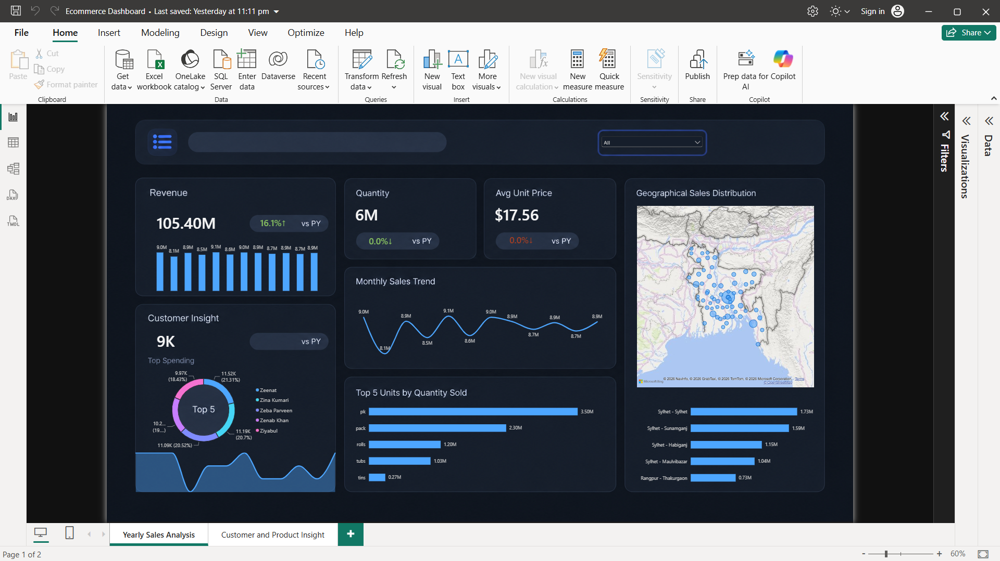
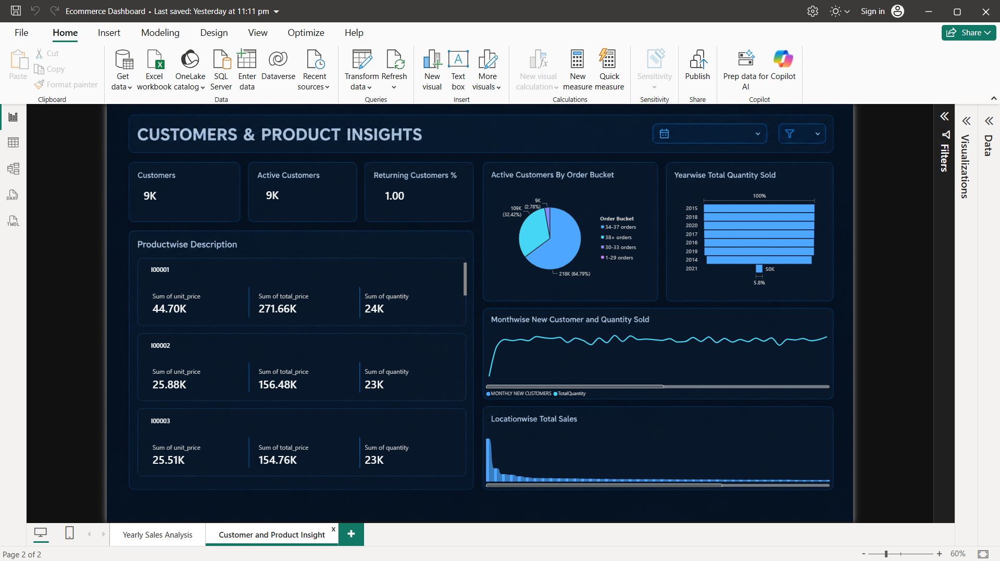

# E-commerce Sales and Customer Analytics Dashboard (Power BI)

A two-page interactive Power BI dashboard analyzing about 1 million transactions across 726 stores, covering sales performance, year-over-year growth, and customer behavior.

## Business Problem
An e-commerce business needs to know whether sales are growing, which store locations drive revenue, and whether customers are coming back. This project is a scenario built around the dataset to answer those questions.

## Goal of the Dashboard
Give one view of sales performance and customer behavior.
- **Page 1 (Yearly Sales Analysis):** How is the business doing over time and by location?
- **Page 2 (Customer and Product Insight):** Who are the customers, and are they staying?

## Key Visuals
- **KPI cards** (Total Sales, Total Quantity, Customers, Average Unit Price) show headline numbers with year-over-year change.
- **Trend charts** (line and column) show sales over time, including seasonality and growth.
- **Store map and bar chart** show which locations drive revenue.
- **Customer visuals** (Active Customers, Returning Customers %, Monthly New Customers) show whether growth comes from new or returning customers.
- **Date slicer** filters every visual to a chosen period.

## Data Model and Tools
- Star schema with 1 fact table and 5 dimension tables (store, customer, time, and others)
- **Power Query** for cleaning and preparation
- **DAX** measures for total sales, quantity, average unit price, YoY growth, and new, returning, and active customers

## Insights
- Total sales were 15.11 Million, a 0.6% increase vs. the previous year.
- Revenue is spread thinly across 726 stores, with the top location (Sylhet) contributing only 1.6%.
- Returning customers made up only about 1% of active customers.
- Sales peaked in May and dipped in February.

## Recommendations
- Test a loyalty or repeat-purchase program, since few customers return.
- Review why weak location underperforms.
- Plan inventory and promotions around the May peak and February dip.

## Repository Structure
- `Data/` source dataset
- `Screenshots/` dashboard images
- `Ecommerce Dashboard.pbix` Power BI file
- `README.md`

## How to Use
Download the `.pbix` file and open it in Power BI Desktop (free, Windows only). Use the slicers and click visuals to filter.

## Author
Pranjal Chauhan | [LinkedIn](http://www.linkedin.com/in/pranjal-chauhan-34a7b3252) | pranjalchauhantech@gmail.com
